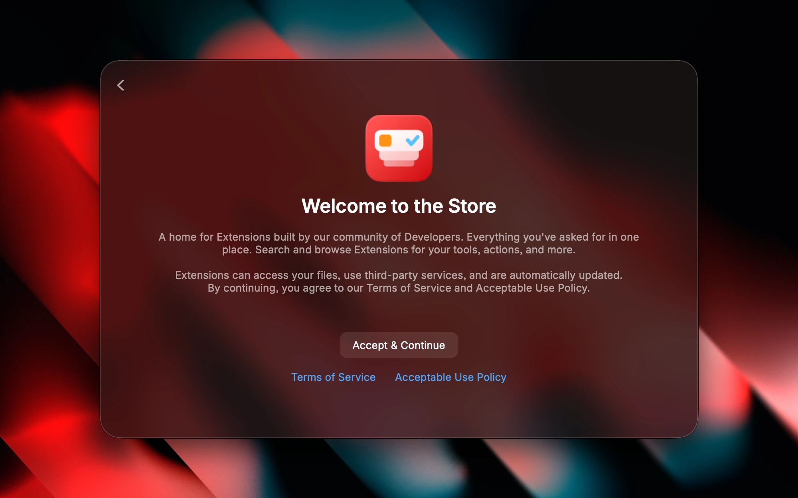
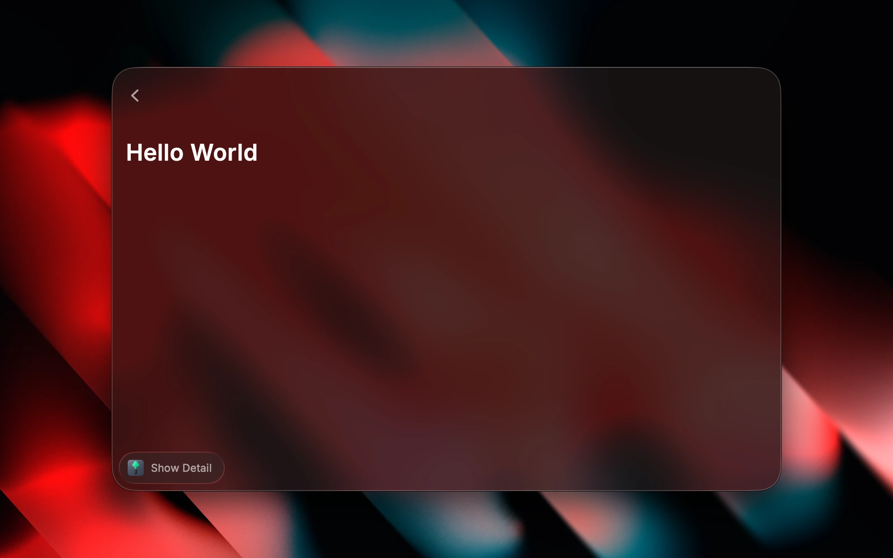
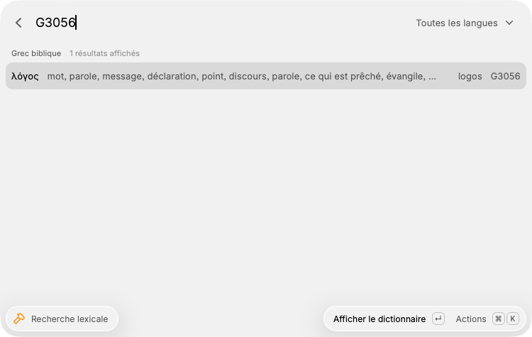
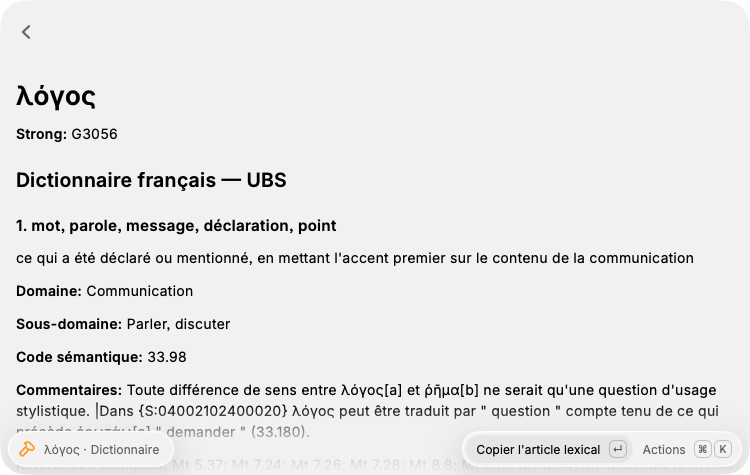

# Installer Bible Lexicon dans Raycast sur Mac

Ce tutoriel part d’un Mac sur lequel Raycast et Node.js ne sont pas encore installés. À la fin, vous pourrez ouvrir **Recherche lexicale**, saisir `G3056` et afficher la fiche de λόγος. Vous pourrez aussi lancer **Lexique biblique** depuis une citation dans Byword, Ulysses ou un éditeur compatible.

Il vous faut un Mac compatible avec la version de Raycast proposée au téléchargement et une connexion Internet pour récupérer les installateurs et les dépendances. Les recherches de Bible Lexicon utilisent ensuite une base locale.

## 1. Télécharger et ouvrir Raycast

1. Allez sur le [site officiel de Raycast](https://www.raycast.com/) et téléchargez la version macOS.
2. Dans le Finder, ouvrez **Téléchargements** et double-cliquez sur le fichier Raycast téléchargé. Si une fenêtre montre **Raycast** et un raccourci **Applications**, faites glisser l’icône de Raycast sur **Applications**.
3. Dans le Finder, ouvrez **Applications**, puis double-cliquez sur **Raycast**. Suivez les étapes de premier démarrage. Si vous avez déjà Raycast, ouvrez l’application existante.
4. Repérez le raccourci affiché dans les réglages généraux de Raycast. Pour ce tutoriel, vous pouvez ouvrir Raycast depuis **Applications** si vous ne connaissez pas encore son raccourci.
5. Connectez-vous à Raycast si l’application vous y invite. La documentation Raycast indique qu’une connexion est nécessaire pour accéder à **Import Extension**. Vous pouvez lancer la commande **Store** pour faire apparaître l’écran de connexion. [Documentation Raycast sur le compte et l’import](https://developers.raycast.com/basics/getting-started)



*Capture officielle Raycast. L’écran de connexion peut varier selon la version de l’application.* [Source de la capture](https://developers.raycast.com/basics/getting-started)

**Vérification.** La fenêtre de recherche de Raycast s’ouvre. Vous pouvez y saisir le nom d’une application ou d’une commande.

## 2. Installer Node.js 24 et vérifier npm

Node.js fournit l’environnement qui sert à préparer l’extension. Son installateur macOS inclut npm, le programme qui récupère les dépendances du projet.

1. Sur la [page de téléchargement de Node.js](https://nodejs.org/fr/download), choisissez la branche **24.x LTS** et l’installateur macOS **.pkg**. Si le site affiche plusieurs architectures, choisissez **ARM64** pour un Mac avec puce Apple, ou **x64** pour un Mac Intel. Le menu ** → À propos de ce Mac** indique le type de puce ou de processeur.
2. Ouvrez le fichier `.pkg` depuis **Téléchargements**, puis suivez l’installateur.
3. Ouvrez **Terminal** depuis **Applications → Utilitaires**, ou en recherchant « Terminal » dans Raycast.
4. Tapez chacune des commandes suivantes, puis appuyez sur **Entrée** après chaque ligne.

```sh
node --version
npm --version
```

**Vérification.** La première commande affiche une version commençant par `v24.` et la seconde affiche un numéro de version. Si Terminal affiche `command not found`, quittez Terminal, rouvrez-le et recommencez. Si l’erreur persiste, vérifiez que l’installateur Node.js s’est terminé.

## 3. Prendre la bonne archive sur GitHub

1. Ouvrez la [page des versions de Bible Lexicon](https://github.com/mattgiralt/bible-lexicon/releases/latest).
2. Sous **Assets**, téléchargez **bible-lexicon-source.zip**. C’est cette archive qui réunit le code et la base SQLite requise pour les recherches.
3. Dans le Finder, ouvrez **Téléchargements**. Double-cliquez sur le fichier ZIP si macOS ne l’a pas déjà décompressé.
4. Déplacez le dossier obtenu vers un emplacement que vous garderez, par exemple **Documents**. Vous pouvez le renommer `bible-lexicon` si vous souhaitez le retrouver facilement.
5. Ouvrez le dossier. À son premier niveau doivent figurer `package.json`, `package-lock.json`, `src` et `assets`. Dans `assets/data`, vérifiez la présence de `bible.sqlite`.

| Fichier dans GitHub | À quoi il sert |
| --- | --- |
| **bible-lexicon-source.zip** | Archive à utiliser pour ce tutoriel. Elle inclut la base. |
| **bible-lexicon.rayext** | Paquet compilé. Son mode d’import dépend de la version de Raycast. |
| **Source code (zip)** et **Source code (tar.gz)** | Archives automatiques du dépôt. La base SQLite n’y figure pas. |

Si le nom du fichier téléchargé se termine par `(1).zip`, Finder a probablement conservé un autre exemplaire du même téléchargement. Vérifiez surtout les fichiers présents dans le dossier extrait.

## 4. Installer les dépendances dans le bon dossier

La méthode du glisser-déposer évite de saisir à la main un chemin contenant des espaces.

1. Gardez ouverts **Finder**, avec le dossier `bible-lexicon` visible, et **Terminal**.
2. Dans Terminal, tapez `cd` suivi d’une espace, sans appuyer sur Entrée.
3. Faites glisser le dossier complet depuis Finder dans la fenêtre du Terminal. macOS ajoute son chemin après `cd`.
4. Appuyez sur **Entrée**, puis tapez les commandes suivantes.

```sh
pwd
ls package.json package-lock.json assets/data/bible.sqlite
npm ci
```

`pwd` affiche le dossier courant. La commande `ls` doit afficher les trois fichiers demandés. Si elle dit qu’un fichier est introuvable, ouvrez le dossier qui contient réellement `package.json` et recommencez l’étape du glisser-déposer. Lancez `npm ci` depuis ce dossier.

**Vérification.** Une fois `npm ci` terminé, Terminal rend la main et le dossier `node_modules` apparaît. Des avertissements peuvent s’afficher. Si npm signale une erreur et s’arrête, voyez la section de dépannage ci-dessous.

## 5. Importer Bible Lexicon dans Raycast

1. Ouvrez Raycast et saisissez **Import Extension** dans la barre de recherche.
2. Choisissez la commande **Import Extension** de la catégorie **Developer**, puis validez avec **Entrée**.
3. La fenêtre **Select Extension to Import** s’ouvre. Dans sa barre latérale, cliquez sur **Documents** si vous y avez placé le dossier, puis sélectionnez le dossier `bible-lexicon` lui-même. C’est le dossier qui contient directement `package.json`.
4. Validez avec le bouton proposé par Raycast. Laissez Raycast finir le chargement.
5. Ouvrez à nouveau la recherche principale et tapez **Recherche lexicale**. Vous devriez voir cette commande associée à **Bible Lexicon**. Recherchez aussi **Lexique biblique** pour vérifier que les deux commandes sont présentes. [Import des extensions locales dans Raycast](https://developers.raycast.com/basics/getting-started)

### Si Import Extension ne suffit pas

Revenez dans Terminal, dans le dossier où vous avez exécuté `npm ci`, puis lancez cette commande une fois.

```sh
npm run dev
```

Laissez Terminal ouvert pendant la compilation. Quand la commande apparaît dans Raycast, ouvrez **Recherche lexicale** et faites l’essai de l’étape suivante. Revenez ensuite dans Terminal et pressez **Contrôle + C** pour arrêter le mode développement. Raycast conserve l’extension après cet arrêt. [Documentation Raycast sur le mode développement](https://developers.raycast.com/basics/create-your-first-extension)



*Exemple officiel Raycast avec une extension de démonstration. Dans votre installation, cherchez les commandes de Bible Lexicon.* [Source de la capture](https://developers.raycast.com/basics/create-your-first-extension)

## 6. Faire une première recherche

1. Dans Raycast, lancez **Recherche lexicale**.
2. Saisissez `G3056`. Laissez **Toutes les langues** ou choisissez le grec.
3. Une ligne **λόγος** apparaît avec le numéro **G3056**. Sélectionnez-la et appuyez sur **Entrée** pour ouvrir le dictionnaire.
4. Utilisez la flèche de retour pour revenir aux résultats. Le panneau **Actions** donne accès aux autres commandes disponibles pour l’entrée.



*Recherche de G3056 dans Bible Lexicon.*



*Début de la fiche du dictionnaire pour λόγος.*

## 7. Analyser un mot sélectionné dans une citation

1. Dans Byword ou Ulysses, ouvrez un document de test et collez la citation suivante sur une ligne.

```text
Jn 1.14 (LSG) : Et la parole a été faite chair, et elle a habité parmi nous, pleine de grâce et de vérité.
```

2. Sélectionnez uniquement **parole**, sans l’espace qui précède ou qui suit.
3. Avec l’éditeur encore au premier plan, ouvrez Raycast avec son raccourci et lancez **Lexique biblique**.
4. Si macOS demande une autorisation au premier essai, suivez l’étape suivante, revenez dans l’éditeur et relancez la commande avec le mot sélectionné.

Pour une citation qui couvre plusieurs versets, indiquez la plage dans la référence et les numéros dans le passage. Dans la version `v1.0.0` téléchargeable, placez la référence **avant** la citation. La prise en charge d’une référence après les guillemets a été ajoutée sur la branche `main` après cette version.

### Autoriser la lecture de la sélection si macOS le demande

**Recherche lexicale** fonctionne sans lire le contenu d’une autre application. Les réglages suivants concernent **Lexique biblique**, qui doit lire le texte et la position du mot sélectionné.

- Dans ** → Réglages Système → Confidentialité et sécurité → Accessibilité**, activez l’accès pour Raycast si le système vous y invite. Si l’application ne figure pas dans la liste et que la lecture échoue, ajoutez Raycast depuis **Applications**. [Aide Apple sur l’accessibilité](https://support.apple.com/fr-gq/guide/mac-help/mh43185/mac)
- Si macOS demande si Raycast peut contrôler **System Events** lors de cette recherche, autorisez cette action pour permettre la lecture. Vous pouvez retrouver le réglage dans **Confidentialité et sécurité → Automatisation**, sous Raycast, lorsque l’entrée apparaît. [Aide Apple sur l’automatisation](https://support.apple.com/fr-ne/guide/mac-help/mchl07817563/mac)

**Vérification.** La commande affiche l’analyse de la citation et les correspondances disponibles. Lorsqu’un mot ne peut pas être associé avec suffisamment de certitude ou que l’éditeur ne fournit pas la sélection, utilisez **Recherche lexicale** pour chercher le mot ou son identifiant directement.

## Dépannage

| Symptôme | Vérification et action |
| --- | --- |
| Raycast est installé mais le raccourci ne l’ouvre pas. | Ouvrez Raycast depuis **Applications**, puis vérifiez le raccourci configuré dans ses réglages généraux. |
| **Import Extension** n’apparaît pas. | Vérifiez que vous êtes connecté à Raycast, puis saisissez le nom exact de la commande. |
| `npm ci` indique `ENOENT` ou ne trouve pas `package.json`. | Vérifiez le dossier courant avec `pwd` et `ls package.json`. Rouvrez Terminal dans le dossier extrait qui contient ce fichier. |
| `node` ou `npm` est introuvable. | Rouvrez Terminal après l’installation de Node.js 24 et vérifiez les deux commandes de version. |
| La base est introuvable ou une erreur SQLite apparaît. | Vérifiez `assets/data/bible.sqlite`. Téléchargez de nouveau **bible-lexicon-source.zip**, extrayez-le et importez le dossier complet. |
| Les commandes sont absentes après l’import. | Lancez une fois `npm run dev` depuis le dossier préparé et attendez la compilation. Vérifiez dans **Raycast Settings → Extensions** que Bible Lexicon et ses commandes sont activés. |
| La référence est introuvable. | Essayez la citation de l’étape 7 avec la référence au début et le mot entier sélectionné. |
| Raycast cite la mauvaise application dans son message. | Retournez dans l’éditeur, sélectionnez le mot, puis ouvrez Raycast directement depuis cette fenêtre. |
| La sélection reste illisible. | Vérifiez les autorisations de Raycast et essayez dans un champ de texte éditable de Byword ou d’Ulysses. Pour un autre champ, utilisez **Recherche lexicale**. |

## Mettre à jour sur un autre Mac

Reprenez le même parcours sur chaque Mac. À chaque nouvelle version, téléchargez la dernière archive, extrayez-la dans un dossier que vous pourrez identifier, exécutez `npm ci` et importez ce dossier. Vérifiez la nouvelle installation avec `G3056`. Les autorisations de lecture de la sélection se règlent séparément sur chaque Mac.

[Versions GitHub](https://github.com/mattgiralt/bible-lexicon/releases) · [Présentation de l’extension](../../README.md) · [Signaler un problème](https://github.com/mattgiralt/bible-lexicon/issues)
